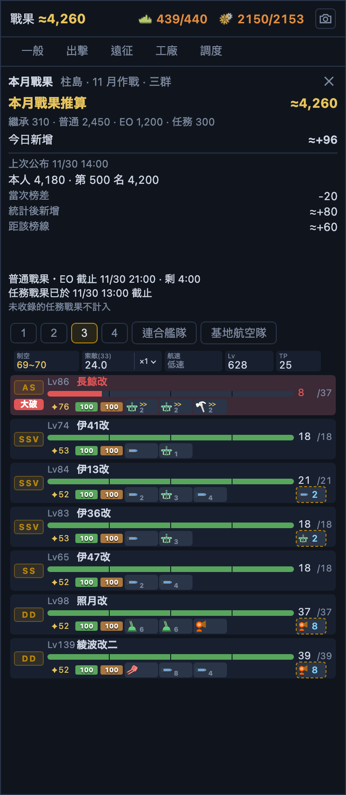

# 本月戰果面板提案

2026-11-22｜規劃中。建議先試「可釘選的頁首戰果」：衝排名的玩家在出擊、回港、再出擊之間，都能一直看到本月總額；點開頁首數字，就以 270 px 托盤取代資訊區顯示明細。資料先以提督經驗值換算普通戰果，再逐步補上 EO、任務戰果與榜單校準。以下社群觀察來自玩家自述與按月回報，代表幾種確實存在的玩法，無法據以估計各類玩家的比例。

## 方案 A 互動預覽

[開啟繁中預覽](../.preview/panel-monthly-senka-zh-TW.html) · [English](../.preview/panel-monthly-senka-en.html) · [日本語](../.preview/panel-monthly-senka-ja.html)。頁面使用離線假資料，場景與出擊預覽共用同一個七艘編成的大破畫面。

- **開關只有一個**：面板外的勾選框模擬「情報總括」裡的偏好設定。未釘選時，頁首維持「提督名 Lv」，不多加箭頭，也沒有可點的入口。
- **明細是托盤，不是浮層**：點頁首戰果開啟，托盤取代 `#tabpanel`，固定 270 px，下方編成、大破標記與油彈士氣都不會被遮住。再點一次數字、按關閉鈕、按 Esc 或點任一分頁即可收起；收起後回到原分頁，焦點回到頁首數字。
- **出擊自動收起**：按「模擬進點」，模擬出擊開始、進點或新戰鬥封包到達時托盤自動收起。
- **情境**：可切換月底追榜、五位數、僅普通戰果、缺本月起點四種情境，也能切換淺色主題，以及測試未釘選時的 12 字提督名。
- 網址加上 `#open` 會直接以「月底追榜」開啟托盤，供擷取下方截圖使用。



上圖為繁中「月底追榜」開啟托盤時擷取的 `.pv-app` 截圖。版面定案或數值變更時，以同一情境重新擷取。

預覽與出擊預覽一起產生。在新的工作目錄或修改後，於專案根目錄執行：

```sh
npx vite-node --config vitest.config.ts tools/preview/panel-sortie.ts
```

調整位置、互動或文案時，同步更新本文件與[戰果預覽產生器](../tools/preview/panel-monthly-senka.ts)。出擊與七艘編成來自[共用場景](../tools/preview/panel-sortie.ts)。下方「月底試排數值」由產生器直接讀取，編輯後重新產生即可更新三語預覽。產出頁放在 Git 忽略的 `.preview/`，請改來源檔。

## 玩家在什麼時候需要戰果

| 使用時機 | 玩家紀錄與意義 |
|---|---|
| 選擇要拚的月份與群別 | 各伺服器分別排名：聯合為第 1～5 名、一群第 6～20 名、二群第 21～100 名、三群第 101～500 名，裝備褒獎依群別而異。有玩家集中使用季度任務挑戰三群，也有玩家每天按自己的節奏打，接近月底才決定目標。面板要能只看累積值，也要容許月中改目標。[PTT 月次獎勵實例](https://www.ptt.cc/bbs/KanColle/M.1777545916.A.048.html)・[艦Path 的季度與持續三群經驗](https://kanpath.blog/2026/11/03/戦果入門　～初ランカーから継続三群まで～/)・[PTT 玩家〈戰果畢業〉](https://www.ptt.cc/bbs/KanColle/M.1674184274.A.E49.html) |
| 平日周回 | 有玩家比較每小時周回累積的普通戰果，也有玩家把每日進度和保留到月底的 EO（擴張作戰）分開記。一次領取大筆特別戰果，和這一小時的周回效率是兩件事，所以明細要拆開組成，並顯示今日新增。台灣玩家也記錄了選陣形前查看戰況與隊伍的習慣，戰果顯示要讓出戰況與大破警告的位置。[玩家的周回時速紀錄](https://note.com/capycolle/n/n9d5f7a978ace)・[PTT 玩家實戰回顧](https://www.ptt.cc/bbs/KanColle/M.1674184274.A.E49.html) |
| 比較本服榜線 | 社群彙整的 2026 年 10 月月底最後一次公開榜，第 500 名在柱島為 **4,129**、吳為 **3,521**、大湊為 **3,007**。同樣是三群目標，柱島與大湊相差 **1,122**；柱島 9 月同一欄又是 **4,358**。每筆比較都需要伺服器、作戰月份、群別與榜次。[社群逐服逐月榜線表，2026 年第 500 名](https://wikiwiki.jp/kancolle/称号・戦果#border) |
| 月底最後一次公布後 | 玩家的長期紀錄會把最後公開名次、榜後自己新增的戰果、後來得知的名次分欄記錄。也有台灣玩家記錄最後公布時第 11 名、靠 EO 追進聯合的實例。榜後仍看得見自己的進度，但其他人的最終分數無法由該次榜單得知。[玩家逐月對帳](https://tsukapon-xbcc.hatenablog.com/entry/ar821416)・[PTT 玩家實戰回顧](https://www.ptt.cc/bbs/KanColle/M.1674184274.A.E49.html) |

## 戰果的組成與時間窗

依 [wikiwiki「称号・戦果」](https://wikiwiki.jp/kancolle/称号・戦果)。時刻皆為日本時間；介面一律換算成本機時區，經 `utils/date-format.ts` 顯示，並附剩餘時間。

| 組成 | 計算與時間窗 | 加算時點 |
|---|---|---|
| 繼承戰果 | （當年 1/1 00:00～前月末 21:59 的提督經驗值 ÷ 50000）＋（前月作戰的特別戰果 ÷ 35）。1 月作戰為 0；12 月作戰的任務戰果不影響隔月繼承。 | 月次作戰開始時 |
| 普通戰果 | 前月末 22:00～當月末 21:59 取得的提督經驗值 × 7 / 10000。演習與遠征的提督經驗也算在內。 | **回港時**；月末 22:00 以後回港，就算下個月 |
| EO 戰果 | 當月 1 日 00:00～月末 21:59 擊破 EO 量表。月末 22:00～23:59 擊破的不計入。 | 戰鬥結束畫面淡出時 |
| 任務戰果 | 前月末 14:00～當月末 13:59 完成的任務。季度任務在 2／5／8／11 月末 13:59 前沒完成，該季戰果即消失；年度任務例外，換季月可以加算兩次。 | 按下「達成」時（有選擇報酬時，在全部選定後） |

- 排行榜每天 03:00、15:00 更新，顯示的是更新前 1 小時（02:00、14:00）的值；最後一次公開榜是月末 15:00。最終排名在月末 22:00 確定，但要到隔月褒獎發放時才看得到。
- 1 日 03:00 的榜分＝繼承戰果＋前月末 22:00～1 日 01:59 的普通戰果＋1 日 00:00～01:59 的 EO＋前月末 14:00～1 日 01:59 的任務戰果。

## 三個版面方案

以下是根據上述紀錄提出的設計推論，示意分數均為假設情境。

| 方案 | 放在哪裡、玩家怎麼讀 | 適合誰、代價是什麼 |
|---|---|---|
| **A．可釘選的頁首戰果（首選）** | 在情報總括開啟偏好後，頁首以「戰果 ≈4,260」取代提督名與等級；右側艦娘容量、裝備容量與相機維持原位。點數字開啟 270 px 托盤，關閉後回到原分頁。 | 平日周回、月底追榜都能用，玩家可全程停在出擊畫面。代價是釘選時讓出提督名與等級，而且托盤開著時看不到原分頁，所以出擊時要自動收起。 |
| **B．一般 → 戰果** | 在「母港／任務／道具」旁增加「戰果」。在既有 270 px 內容區先放本月總額，下一行放本服目標群別、最近榜次及差額，下方列出已計入的普通戰果、EO 與任務戰果。 | 適合集中交季度任務、偶爾回港核對的玩家。閱讀空間較充足；但連續出擊時，每次查閱都要切頁。 |
| **C．本次周回計數** | 玩家主動從頁首啟動「本次周回」，點按可切看「本次普通戰果 +38」，結束後回到提督身分。起訖時間與平均時速放在明細。 | 適合比較周回配置、只在打戰果時才需要讀數的玩家。操作比 A 多；EO 與任務獎勵要另外列，才不會扭曲時速。普通戰果有了經驗值主幹之後，增量可信，可以在 A 之後再試。 |

**建議先做 A。** 三案中，A 最直接服務一場接一場出擊的使用時機，也讓沒在衝排名的人沿用現有面板。頁首只讓出一個身分欄的空間；總分、榜差、時速若同時塞進頁首，會犧牲容量警示的可讀性，所以這些都放進托盤。若主要需求是管理季度任務，優先試 B。[現有頁首](../entrypoints/panel/main.ts)・[一般分頁](../entrypoints/panel/general.ts)・[面板尺寸與預覽契約](design-guidelines.md)

### 頁首與偏好

- 偏好只有一個，放在情報總括，經 storage 事件同步到面板；這與語言、主題同樣只在情報總括設定的慣例一致。面板不寫入這個偏好。
- 開關建議放在情報總括新增的「戰果」分區（側欄排在「資源紀錄」之後）的工具列第一項，而不是總括頁首的語言、主題旁邊。理由：總括頁首只放影響所有頁面的全域設定，戰果只和衝排名的玩家有關；第二期的目標群別、榜線登錄與逐月對帳也會放在同一個分區，找得到戰果就找得到開關。1a 時這個分區只有開關與本月普通戰果摘要。[情報總括預覽](../.preview/overview-monthly-senka-zh-TW.html)可以切換兩種位置比較；在另一個分頁開著面板預覽時，總括這邊一勾選，面板頁首就會即時同步。
- 頁首用短標籤：繁中「戰果」、英文「Pts」、日文「戦果」；完整名稱放在 `title` 與無障礙名稱。只有普通戰果時（見下節 1a），標籤改為「普通戰果」／「Reg. pts」／「通常戦果」，以免玩家把部分值誤當總分。
- 頁首照樣經 `--hs` 等比縮小。正式版的 `fitHeaderScale()`（`entrypoints/panel/header-fit.ts`）目前在找不到 `.nick` 時就不縮放；實作時要改成只看 `header.scrollWidth`，或讓隱藏的提督名留在 DOM 內。不要為英文另寫間距特例。驗收以英文五位數加上 3 位艦數、4 位裝備數為最寬情境。

### 情報總括的戰果分區

分區內容隨分期增加。預覽控制列的「內容階段」可以切換三個階段：

| 階段 | 分區內容 |
|---|---|
| 1a | 開關、本月普通戰果、今日新增、截止時刻 |
| 1b | 已觀測戰果（不含繼承分）與組成；EO 擊破清單（含未擊破的海域與可得戰果，月底可據以決定今晚要打哪張）；已計入的任務戰果 |
| 第二期 | 左欄「本月」：本月戰果推算、繼承分的校準時刻、所選目標（群別或自訂分數）的榜線與差額。右欄「榜線紀錄」：看排行榜時自動記下的本人戰果，以及玩家登錄的其他名次榜線。下方整寬「逐月對帳」：各月組成、推算總額、最後公開名次，以及玩家自填的最終結果 |

- 目標選了某個群別，但本月還沒登錄該名次的榜線時，只顯示「—」並提示尚未登錄，不顯示差額，也不拿別月的榜線來代替。
- 逐月對帳中的區間，代表月界前後的回港讀數不同，無法確定歸屬（見下方「1a：普通戰果與跨月邊界」）。

### 托盤的開關

- 托盤和 `#photo-tray` 一樣取代 `#tabpanel`，開啟時分頁列不標示選取。
- 出擊時自動收起，觸發條件沿用 `entrypoints/panel/main.ts` 重設大破卡的條件：`api_req_map/start`、`api_req_map/next` 與 `isNewBattlePacket(path)`，不要另外列舉路徑。這是刻意與寫真托盤不同的地方：寫真托盤出擊時不會收起，但戰果明細和戰況、大破警告搶的是同一塊 270 px，不能讓它在進點時擋住出擊資訊。在母港收遠征或切任務時不自動收起。

## 點開 A 時，明細要回答什麼

假設情境：月底 17:00（以下皆為台灣本機時間），玩家想判斷今晚還要不要繼續周回。

```text
本月戰果                柱島 · 11 月作戰 · 三群   ✕
本月戰果推算                               ≈4,260
繼承 310 · 普通 2,450 · EO 1,200 · 任務 300
今日新增                                     ≈+96
上次公布 11/30 14:00
本人 4,180 · 第 500 名 4,200
當次榜差                                      −20
統計後新增                                   ≈+80
距該榜線                                     ≈+60
普通戰果・EO 截止 21:00 · 剩 4:00
任務戰果已於 13:00 截止
未收錄的任務戰果不計入
```

- **今日新增**以遊戲換日（日本時間 05:00）為界，回答平日周回的進度；這條界線要在預覽中確認玩家能否理解。
- **當次榜差**是同一榜次的兩個值相減；**距該榜線**是目前推算值減去該次榜線。例中的 +60 只代表自己已超過下午公布的分數，最終名次仍待揭曉。平日顯示該次榜單的公布時刻；月底最後一次更新後，才改稱「最後公開榜線」。
- 有目標群別才顯示對應榜差。玩家自訂的目標分數要標「距自訂目標」，即使數字相同，也要保留兩者意義的差別。
- 月底最後一天才顯示截止倒數與任務截止提示；平日的底列改顯示下次榜單更新的倒數。

### 月底試排數值

以下依序是繼承、普通、EO、任務、今日新增、同一榜次的本人戰果與目標名次榜線。預覽以前四項加總為推算值，「統計後新增」＝推算值 − 本人榜分。

<!-- senka-preview -->
```json
{ "inherit": 310, "normal": 2450, "eo": 1200, "quest": 300, "today": 96, "published": 4180, "border": 4200 }
```

## 資料來源與分期

專案將戰果估算列在[補完計畫](completion-plan.md)第 5 節。下列分期的每一步，都依[專案被動觀察與欄位證據規範](../AGENTS.md)：只讀遊戲既有流量，欄位需有樣本或成熟工具的實際解析佐證。

| 分期 | 資料 | 可顯示 | 狀態 |
|---|---|---|---|
| **1a 普通戰果** | `api_port/port` 的 `api_data.api_basic.api_experience`（`samples/slot_to_port.json` 有此欄位） | 普通戰果、今日新增、月底截止倒數。頁首與托盤都標「普通戰果」，托盤註明「EO、任務與繼承分未計入」。 | 有公式、有樣本，可以先做 |
| **1b 任務戰果** | 既有的 `questObserved`（`clearitemget` 請求的 `api_quest_id`、`ts`）＋任務目錄的戰果值 | 任務戰果、待領任務的規劃項目 | 戰果值是公開的固定值，不需要新樣本。目錄的戰果數值目前只寫在 `otherJa` 文字中，要先解析成結構化欄位並以測試鎖住 |
| **1b EO 戰果** | 既有的 `db.sorties.cleared` 轉變偵測＋當月 `db.snapshot` 的 `api_get_member/mapinfo`（`api_cleared === 1`；`samples/6-5-mapinfo.json` 有樣本）＋海域固定戰果表 | EO 戰果、未擊破海域與可得戰果 | 可以做。合併同月 `sorties` 與 `mapinfo` 快照（涵蓋先前已擊破、跨裝置與 1-6 無 Boss 戰）；月末 22:00～23:59 擊破的不計入 |
| **2 榜單校準與總括紀錄** | 排行榜封包；情報總括的目標群別、榜線紀錄與逐月對帳 | 本月戰果推算、當次榜差、距該榜線；首月補上繼承分 | 可以做。解碼已以 `samples/ranking-page-*.json` 三頁真實樣本驗證（見下節）。被動觀察不主動查榜：玩家翻到哪一頁，就記下哪一頁；沒看過的名次由玩家手動登錄 |

1a、1b 只有部分組成時，總額不稱「本月戰果」。等四項組成都有依據（或取得榜分校準）時，才顯示「本月戰果推算」。

### 1a：普通戰果與跨月邊界

- 只在 `path === 'api_port/port'` 時讀 `api_experience`。這個時點正好是遊戲加算普通戰果的回港時刻；不混入 `api_get_member/basic`、`record`，以免時序有歧義。
- 經驗值是累計的絕對值：中途在別的裝置上玩，下次回港讀到的值也會包含那段經驗。
- 月界：月末 22:00（日本時間）。`ts` 是 UTC 毫秒，月界要明確以日本時間換算，不能依賴本機時區。令 E_before 為月界前最後一筆有 `exp` 的讀數，E_after 為月界後第一筆：
  - E_after ＝ E_before：邊界確定，不論兩筆相隔多久。
  - E_after ＞ E_before，且 E_before 落在前一個作戰月內（前前月末 22:00～前月末 21:59）：本月起點顯示為區間，寬度 (E_after − E_before) × 7 / 10000。同一個區間同時套用到上月的最終值與本月的起點。
  - E_before 更早、或根本沒有 E_before（例如功能上線後的第一個月）：本月起點不可考，總額顯示「—」，只顯示「觀測期間新增」。這個值正好是區間的下界，退回時不會丟掉確定的資訊。
  - E_after ＜ E_before：資料異常，不顯示月總額。
- 上月最終值的區間只在第二期的逐月對帳用得到，1a 面板只顯示本月。整個作戰月都沒有讀數時，該月標示為沒有資料，不顯示 [0, x] 區間。

### 1b：任務戰果

- 目錄目前有 10 筆含戰果的任務。只有 949（B170）的戰果放在選擇報酬裡（選擇報酬 2：戰果 +800），`questObserved` 無法得知玩家選了哪一項，計為區間 0／+800。等 `clearitemget` 的真實樣本確認選擇參數之後，才考慮在 `QuestObservedRow` 加選填欄位。
- 期間限定任務每年會重用同一個編號，內容卻不同。查目錄時要遵守期間限定任務的有效期間規則，超出期間的編號一律不計入。
- 不在目錄裡的任務不逐筆列出，因為單靠 `questNo` 分不出一般任務和戰果任務。托盤統一註明「未收錄的任務戰果不計入」。若之後的樣本證實 `clearitemget` 回應能直接讀出實收戰果，目錄落後和選擇報酬兩個問題可以一起解決。

### 1b：EO 戰果

EO 擊破的戰果是各海域的固定值：1-5 +75、1-6 +75、2-5 +100、3-5 +150、7-5 +170、4-5 +180、5-5 +200、5-6 +225、6-5 +250（[wikiwiki「称号・戦果」](https://wikiwiki.jp/kancolle/称号・戦果)）。擊破來源同時合併兩處，依海域去重後查表加總（時刻皆須落在當月 1 日 00:00～月末 21:59 日本時間），不需要新增資料表：

1. `db.sorties` 中 `cleared === true`（排除 `catchOnly`）的資料列：由 `EventProjector.markLatestBossCleared()` 在同一會話觀測到海域由未擊破轉為已擊破時標記。
2. `db.snapshot` 中當月有效時間窗內的 `api_get_member/mapinfo` 快照：擷取上表 EO 海域中 `api_cleared === 1` 的項目，補齊開面板前已擊破、事件已裁剪、跨裝置與 1-6（無 Boss 戰）等無法從 `db.sorties` 取得擊破列的月份進度。

戰鬥結果裡的 EO 戰果欄位沒有樣本，不使用。

### 第二期：排行榜解碼

`api_req_ranking/mxltvkpyuklh` 每頁 10 列。名次在 `api_mxltvkpyuklh`，戰果經過混淆放在 `api_wuhnhojjxmke`：

1. 混淆值除以名次對應的係數 `[8931,1201,1156,5061,4569,4732,3779,4568,5695,4619,4912,5669,6586][名次 % 13]`。
2. 同一頁 10 個商的最大公因數，就是該玩家的係數。
3. 戰果＝混淆值 ÷ 名次係數 ÷ 玩家係數 − 91。

`samples/ranking-page-1.json`、`-51`、`-147` 三頁共 30 列，解碼結果和遊戲畫面截圖逐列一致（三頁的玩家係數皆為 44），演算法與 poi 外掛 `poi-plugin-senka-calc`（MIT）的 `lib/magic.js` 相同。實作時依 clean-room 重寫，並登錄於 `THIRD-PARTY-NOTICES.md`。

- 任何一頁都能自行解出係數，所以玩家翻到第 50 頁看第 500 名時，就能自動記下該次榜線，不限於本人那一頁。
- 某一頁出現無法整除的情況時，代表混淆方式改了：該頁不解碼、不記錄，並保留原值。
- 本人那一列以 `api_port/port` 的提督名比對。
- 排行榜回應不含榜次，以擷取時刻推定（每天 03:00、15:00 更新）。結算期間打開，看到的可能是前一次的榜。
- `api_itslcqtmrxtf`、`api_pbgkfylkbjuy`、`api_pcumlrymlujh` 語意未證實，不使用。

### 校準基線

在當月任一次統計點 T（02:00／14:00），以本人榜分減去本機從月起點到 T 的已觀測增量，就能得到繼承戰果或基線差額。前提是這段期間的增量全部都有觀測到：只要有一段在別的裝置上打過 EO 或交過任務，算出的基線就會偏高，而且無從察覺。所以越早看榜越準，有特別戰果空窗時要標為推算。經驗值換算出來是小數、榜分是整數，校準結果允許 ±1 的誤差。新基線到來時，已納入該次榜分的增量只計一次。

### 持久化與備份

- 不另建資料表。`resources` 已經由 background 在每次 `api_port/port` 冪等寫入一列（`utils/resource-capture.ts`），面板關著也會記錄；在 `ResourceRow` 加選填的 `exp`，只有 `api_port/port` 的資料列才寫入，`api_get_member/material` 的資料列沒有這個欄位。讀戰果時只取有 `exp` 的資料列。`exp` 不建索引，Dexie 不必升版；舊資料列不回填。
- 不壓縮資料。每月大約幾千列，量很小；壓縮等於刪除衍生資料，重新投影時還可能把刪掉的列寫回去。
- 備份比照 v12 的前例：`BACKUP_SCHEMA_VERSION` 升到 13，讓舊版擴充明確拒絕新的備份檔，而不是默默丟掉 `exp`。
  - `validateResource()` 目前會重建整列、丟掉未知欄位，要改成接受選填的 `exp`（非負安全整數），並把檔案版本傳進去：版本低於 13 的檔案若夾帶 `exp` 就拒絕；沒有 `exp` 的舊備份照常匯入。
  - 同步更新 `docs/structure.html` 的錨點 `backup-schema`（`tests/structure-doc.test.ts` 會比對）與 `docs/engineering/backup.md`。
  - 補一個往返測試：帶 `exp` 的資料列經過匯出再還原後仍然保留。

## 實作分工與子代理分派

依 [補完計畫](completion-plan.md) 第 3 節的通則：主 session 負責資料模型、介面接線與驗收；規格已寫死、可獨立驗收的工作分派給較便宜的模型（子代理，Sonnet 5.5）。每項做完都在可 commit 的狀態結束；commit 條件見 `AGENTS.md`「工作方式」。

### 任務表

「主」＝主 session 自己做；「派」＝寫好規格後交給子代理，主 session 驗收。✅ 表示已驗收並 commit，後面是 commit。

| 代號 | 內容 | 誰做 | 規格出處 | 主 session 驗收重點 |
|---|---|---|---|---|
| **1a-1**<br>✅ e356c9a | 純函式：月界換算（日本時間月末 22:00）、經驗值 × 7 / 10000、E_before／E_after 四種判斷、今日新增（日本時間 05:00 換日）、截止倒數。無 `chrome.*`／DOM，附 Vitest | 派 | 「戰果的組成與時間窗」「1a：普通戰果與跨月邊界」 | 測試涵蓋「原型驗收」資料案例的前三項與長休；用 UTC 毫秒換算日本時間，不依賴本機時區 |
| **1a-2**<br>✅ 644e8fc | `ResourceRow.exp`（只在 `api_port/port` 寫入）、`validateResource()` 接受 `exp` 並帶入檔案版本、`BACKUP_SCHEMA_VERSION` 升 13、`docs/structure.html` 錨點、`docs/engineering/backup.md`、往返測試 | 主 | 「持久化與備份」 | 動資料格式，依 `docs/task-template.md` 分流表先向開發者說明再動手；`npm run check` |
| **1a-3**<br>✅ f4e2da6 | 面板：頁首戰果、270 px 托盤、出擊自動收起、`header-fit.ts` 不再依賴 `.nick` | 主 | 「頁首與偏好」「托盤的開關」、面板預覽 | 面板預覽同情境三語截圖對照；寫真托盤與戰果托盤不會同時開啟；自動收起沿用重設大破卡的同一組條件 |
| **1a-4**<br>✅ e356c9a | 三語文案寫進 `utils/ui-i18n.ts`（沿用預覽產生器 `copy` 的字串） | 派 | 預覽產生器的 `copy`／`overviewCopy` | 三語鍵齊全；沒有資料來源字樣（設計規範 §2.5） |
| **1a-5**<br>✅ f4e2da6 | 情報總括「戰果」分區（1a 內容）、在 `sections/index.ts` 排在資源紀錄之後、偏好寫入 `utils/ui-prefs.ts` 並經 storage 事件同步 | 派 | 「情報總括的戰果分區」、總括預覽 | 先畫外殼再讀資料庫（設計規範 §4.2.1）；面板只讀不寫偏好 |
| **1a-6**<br>✅ f4e2da6 | 離線預覽改用正式函式與正式 markup，`tests/panel-monthly-senka-preview.test.ts` 跟著改 | 派 | 現有 `tools/preview/panel-monthly-senka.ts` | 重新產生預覽，在瀏覽器看三語、深淺色 |
| **1b-1**<br>✅ d82d36d | 任務目錄的戰果值：將 `otherJa` 的「戦果+N」解析為結構化查詢（選擇報酬另標），附抽樣與全量測試 | 派 | 「1b：任務戰果」 | 抽樣：854 +350、949 選擇報酬 +800、284 +80；單一來源不重複維護 |
| **1b-2**<br>✅ d82d36d | 純函式：任務戰果（`questObserved`＋目錄＋期間限定任務的有效期間，949 算區間）與 EO 戰果（合併 `db.sorties` 與當月 `mapinfo` 快照＋固定表＋時間窗） | 派 | 「1b：任務戰果」「1b：EO 戰果」 | 月末 14:00～22:00 先領任務再打 EO 的案例；22:00～23:59 擊破不計入 |
| **1b-3**<br>✅ d82d36d | 面板托盤與總括分區加入 EO 與任務（依預覽的 1b 階段） | 派 | 總括預覽「1b」、面板預覽 | 三語版面；未收錄任務的註記 |
| **2-1** | 純函式：排行榜解碼，以 `samples/ranking-page-*.json` 測試 30 列預期值；`THIRD-PARTY-NOTICES.md` 登錄 poi 外掛 | 派 | 「第二期：排行榜解碼」、`samples/README.md` | 無法整除時回 `null`，不記錄；clean-room 重寫，沒有複製程式碼 |
| **2-2** | 資料：排行榜紀錄（本人戰果、看過頁面的榜線、手動登錄）與逐月最終結果的持久化；DB 升版與備份 | 主（最強模型、高 effort，先進 plan mode） | 「第二期」各節 | 動 DB 與備份格式，先向開發者說明相容做法 |
| **2-3** | 純函式：校準基線（繼承分）與目標差額 | 派 | 「校準基線」 | ±1 容差；有特別戰果空窗時標為推算 |
| **2-4** | 總括第二期：目標、榜線紀錄、登錄表單、逐月對帳 | 派 | 總括預覽「第二期」 | 版面與預覽一致；`<details>` 與輸入框不因更新而重繪 |

### Session 順序

依相依關係與所需強度排好，每個 session 的模型與 effort 從頭到尾不變，不會做到一半才發現要換更強的模型。表中「派」的任務一律交給子代理（Sonnet 5.5）。

| 順序 | 模型與 effort | 任務 | 開始前提 | 結束狀態 | 開發者實機檢查 |
|---|---|---|---|---|---|
| 1 ✅ | Opus 5.5 中 | 1a-1（派）、1a-4（派），兩個可以同時派出。2026-11-22 驗收完成（e356c9a） | 這份提案與預覽已 commit | 純函式、測試與三語文案可 commit（依 wikiwiki 規則、測試與 build 全過） | 不需要：沒有接介面，測試即可驗證 |
| 2 ✅ | Opus 5.5 **高** | 1a-2（主）。2026-11-22 驗收完成（644e8fc） | 1 已 commit；動手前向開發者說明備份相容做法並取得同意 | `npm run check` 通過後 commit | 建議一次（不擋順序 3）：見下方「順序 2 的實機檢查」 |
| 3 ✅ | Opus 5.5 中 | 1a-3（主）、1a-5（派）、1a-6（派）。1a-6 等 1a-3、1a-5 的正式 markup 完成後再派；2026-11-22 開發者 live 檢查通過（f4e2da6） | 2 已 commit | 給開發者看預覽並提供 live 手動檢查步驟；確認後 commit。1a 上線 | **需要**：預覽三語與深淺色、live 頁首與托盤、出擊自動收起 |
| 4 ✅ | Opus 5.5 中 | 1b-1（派）→ 1b-2（派）→ 1b-3（派），依序；1b-3 另處理下方「後續接線時要處理的項目」。2026-11-23 開發者實機檢查通過（d82d36d） | 3 已 commit | 預覽經開發者確認後 commit。1b 上線 | **需要**：預覽確認；live 各遇到一次 EO 擊破與任務戰果領取 |
| 5 | Opus 5.5 中 | 2-1（派）、2-3（派），兩個可以同時派出 | 4 已 commit | 純函式與測試可 commit；`THIRD-PARTY-NOTICES.md` 已登錄 | 不需要：以 `samples/ranking-page-*.json` 測試驗證 |
| 6 | **Fable 5.2 高**，先進 plan mode（不能用時改 Opus 5.5 高＋plan mode） | 2-2（主） | 5 已 commit；資料表設計先給開發者看並取得同意 | 遷移與備份往返測試通過後 commit | 建議一次：以真實備份在新版還原，並在遊戲翻一次排行榜，確認有記下 |
| 7 | Opus 5.5 中 | 2-4（派）；面板托盤的榜線區接線（主）；另處理下方「後續接線時要處理的項目」 | 6 已 commit | 預覽經開發者確認、live 手動檢查後 commit。第二期上線 | **需要**：預覽確認、live 手動檢查 |

- 每個 session 只做表中列出的任務。做到一半發現要動 `utils/db.ts`、備份格式或投影，而表上沒寫的，就停下來，把發現寫進這份提案，另開對應強度的 session，不在中度 session 裡硬做。
- 上一個 session 的結束狀態沒有達成（例如預覽還沒經開發者確認），下一個 session 就不開始。
- 「開發者實機檢查」為**需要**的 session，主 session 在 commit 前停下來，提供 `npm run build` 後的手動檢查步驟，等開發者回報結果；agent 不操作 live 遊戲（`AGENTS.md`「Live 遊戲安全」）。「建議一次」不擋下一個 session，但要在結束回報中附上步驟。

#### 順序 2 的實機檢查

1. `npm run build`，在擴充管理頁重新整理擴充，遊戲分頁按 F5。
2. 在遊戲回母港一次。
3. 開情報總括，DevTools → Application → IndexedDB → `resources`：最新一列有 `exp`，數值與提督經驗值一致。
4. 在遊戲開「資材」畫面：`api_get_member/material` 產生的那一列沒有 `exp`。

### 後續接線時要處理的項目

**順序 7（第二期）**

- 英文名次：`senka.rankN`、`ov.skCutoffCell`、`ov.skCutoffName` 的英文 `{rank}`／`{n}` 沒有序數，呼叫端一律傳 `formatSenkaRank(rank, lang)`（`utils/senka-view.ts`，英文會加 st／nd／rd／th，繁中與日文回傳純數字）。

### 分派規格要寫什麼

子代理不讀這份提案的前因後果，規格要能獨立成立：

- **檔案範圍**：要改哪些檔、不可碰哪些檔。同一時間只讓一個子代理改同一組檔案；主 session 正在改的檔案（包括這份提案）不派出去。
- **寫死的值**：三語文案逐字給、測試的預期值逐項給、時間點給 UTC。讓子代理自己決定的文案，回報時要列出來，由主 session 確認。
- **硬約束**：只觀察既有流量、未驗證欄位不得猜、日期走 `utils/date-format.ts`、可見文案不寫來源、不 commit／push。
- **驗收指令**：子代理自己先跑型別檢查、相關 Vitest、預覽產生；介面工作要用瀏覽器在三語、深淺色下量測，並回報數值。

### 主 session 怎麼驗收

子代理的回報不算驗證：

1. 看 diff，確認沒有超出檔案範圍，也沒有規格外的行為。
2. 自己重跑 `npm run check`，逐項比對數字，並留意回報不會提的副作用（新增的建置警告、打包大小變化）。
3. 介面工作：自己重新產生預覽，在瀏覽器看三語與深淺色；子代理沒測到的語言或互動由主 session 補測。
4. 版面有問題時，用 SendMessage 請同一個子代理修，它還保有上下文，比重新派一個便宜。

## 原型驗收

以 370 × 850 px、固定 270 px 資訊區，試排繁中、英文與日文，深色與淺色主題都要看。在同一個七艘出擊場景中，比較未釘選與釘選的頁首，並帶入五位數、僅普通戰果、缺本月起點與兩項容量警示：

- 頁首不超出 370 px，相機鈕完整可見；托盤內容不超出 270 px。
- 托盤開著時，七艘編成與大破標記完整可見，編成底緣達 730 px 目標、未越過 740 px。
- 模擬進點後托盤收起，回到出擊分頁。
- 用鍵盤開關托盤後，焦點與原分頁狀態都能還原。

[面板設計規範 §7](design-guidelines.md)

資料驗收使用下列離線案例，分別核對顯示時刻、差額方向、歸屬月份，以及重新開啟面板後是否重複計入：

- 月界前後讀數相等（包括相隔數月的長休）。
- 月界前後讀數不同，且 E_before 在前一個作戰月內。
- 只有月界後的讀數。
- 月中安裝、只有一次榜分。
- 同服同榜次落後，之後周回追過舊榜線。
- 月底在 14:00 之後完成任務、22:00 之前打完 EO：EO 計入當月，任務戰果計入下個月。
- 949 選擇報酬。
